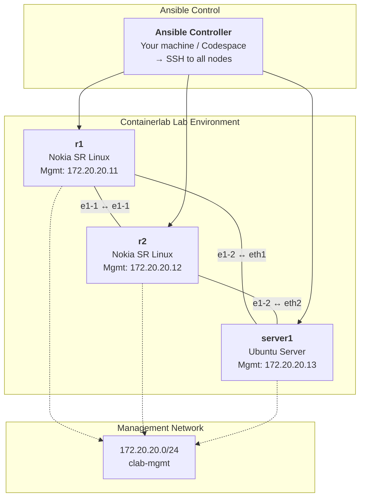

# Network Layout

This document describes the network topology used throughout the Beginner Ansible Workshop. It covers Containerlab for container orchestration and NetLab for network configuration.

## Architecture Overview

The workshop uses a simple three-node topology that demonstrates core networking concepts while remaining easy to deploy and understand:



## Node Details

| Node | Role | Kind | Image | Management IP | Ansible Group | Credentials |
|------|------|------|-------|---------------|---------------|-------------|
| `r1` | Core Router | `nokia_srlinux` | `ghcr.io/nokia/srlinux` | 172.20.20.11 | `srl` | admin / NokiaSrl1! |
| `r2` | Edge Router | `nokia_srlinux` | `ghcr.io/nokia/srlinux` | 172.20.20.12 | `srl` | admin / NokiaSrl1! |
| `server1` | Linux Server | `linux` | `ghcr.io/hellt/ubuntu-netlab` | 172.20.20.13 | `servers` | ubuntu / ubuntu |

### Interface Mapping

| Node | Interface | Connected To | Purpose |
|------|-----------|--------------|---------|
| r1 | e1-1 | r2 e1-1 | Router-to-router link |
| r1 | e1-2 | server1 eth1 | Server uplink 1 |
| r2 | e1-2 | server1 eth2 | Server uplink 2 |

## Management Network

All nodes connect to the Containerlab management network:

- **Subnet:** `172.20.20.0/24`
- **Network Name:** `clab-mgmt`
- **Gateway:** Automatically assigned by Containerlab (typically `.1`)

This network is used exclusively for:
- SSH access from the Ansible controller
- Ansible module communication
- Lab management and troubleshooting

## Containerlab Configuration

The topology is defined in `workshop-beginner.clab.yml`:

```yaml
name: ansible-workshop-beginner

mgmt:
  network: clab-mgmt
  ipv4-subnet: 172.20.20.0/24

topology:
  nodes:
    r1:
      kind: nokia_srlinux
      image: ghcr.io/nokia/srlinux

    r2:
      kind: nokia_srlinux
      image: ghcr.io/nokia/srlinux

    server1:
      kind: linux
      image: ghcr.io/hellt/ubuntu-netlab

  links:
    - endpoints: ["r1:e1-1", "r2:e1-1"]
    - endpoints: ["r1:e1-2", "server1:eth1"]
    - endpoints: ["r2:e1-2", "server1:eth2"]
```

### Deploying the Lab

```bash
# Deploy the Containerlab topology
containerlab deploy -f workshop-beginner.clab.yml

# Verify all nodes are running
containerlab inspect

# View node IPs
containerlab inspect --grep "172.20.20"

# Clean up (remove all containers and network)
containerlab destroy
```

## NetLab Configuration

NetLab provides network configuration management on top of Containerlab. Create `netlab.yml` in the same directory:

```yaml
provider: docker

prefix: workshop

defaults:
  topology:
    links:
      - model: veth
        iface_metadata:
          mtu: 1500

topology:
  hosts:
    r1:
      kind: nokia_srlinux
      image: ghcr.io/nokia/srlinux
      mgmt_ipv4: 172.20.20.11/24
    r2:
      kind: nokia_srlinux
      image: ghcr.io/nokia/srlinux
      mgmt_ipv4: 172.20.20.12/24
    server1:
      kind: ubuntu
      mgmt_ipv4: 172.20.20.13/24

  links:
    - interfaces: [r1:e1-1, r2:e1-1]
      ipv4: 10.0.12.0/30
    - interfaces: [r1:e1-2, server1:eth1]
      ipv4: 10.0.13.0/30
    - interfaces: [r2:e1-2, server1:eth2]
      ipv4: 10.0.23.0/30
```

### NetLab Network Addressing

| Link | Interfaces | Subnet | Gateway (r1/r2) | Server IP |
|------|------------|--------|-----------------|-----------|
| r1↔r2 | e1-1 ↔ e1-1 | 10.0.12.0/30 | .1 / .2 | N/A |
| r1↔srv | e1-2 ↔ eth1 | 10.0.13.0/30 | .1 / .2 | N/A |
| r2↔srv | e1-2 ↔ eth2 | 10.0.23.0/30 | .1 / .2 | N/A |

### Deploying with NetLab

```bash
# Install NetLab
pip install netlab

# Create the lab environment
netlab create netlab.yml

# Apply configuration (if you have Ansible playbooks for network config)
netlab up

# Check status
netlab status

# Destroy the lab
netlab destroy
```

## Ansible Inventory

The inventory (`inventory.yml`) groups nodes by role:

```yaml
all:
  children:
    srl:
      hosts:
        r1:
          ansible_host: 172.20.20.11
        r2:
          ansible_host: 172.20.20.12
      vars:
        ansible_user: admin
        ansible_ssh_private_key_file: "{{ inventory_dir }}/ssh/lab_key"
    servers:
      hosts:
        server1:
          ansible_host: 172.20.20.13
      vars:
        ansible_user: ubuntu
        ansible_ssh_private_key_file: "{{ inventory_dir }}/ssh/lab_key"
  vars:
    ansible_python_interpreter: /usr/bin/python3
```

### Testing Connectivity

```bash
# Verify inventory parses correctly
ansible-inventory --list -y

# Ping all nodes
ansible all -m ping

# Ping only routers
ansible srl -m ping

# Ping only servers
ansible servers -m ping
```

## SSH Key Setup

All nodes use key-based authentication. Generate and deploy keys:

```bash
# Create SSH directory
mkdir -p ssh

# Generate a key pair (if you don't have one)
ssh-keygen -t ed25519 -f ssh/lab_key -N "" -C "workshop-lab"

# Deploy to Ubuntu server
sshpass -p ubuntu ssh-copy-id -o StrictHostKeyChecking=no ubuntu@172.20.20.13

# Deploy to SR Linux nodes (initial setup requires sshpass)
sshpass -p 'NokiaSrl1!' ssh-copy-id -o StrictHostKeyChecking=no admin@172.20.20.11
sshpass -p 'NokiaSrl1!' ssh-copy-id -o StrictHostKeyChecking=no admin@172.20.20.12
```

## Deployment Options

### Option 1: Local Deployment (Recommended)

**Requirements:**
- Docker Desktop, OrbStack, or WSL2 Docker
- Containerlab installed
- Minimum 4 GB RAM allocated to Docker

```bash
# One-liner to get everything running
containerlab deploy -f workshop-beginner.clab.yml
```

**Pros:** Full control, faster image pulls, no internet required after setup

### Option 2: GitHub Codespaces

**Requirements:**
- GitHub account
- Free tier works (but monitor resource usage)

**Setup in Codespace:**
1. Create a new Codespace from this repository
2. Install dependencies:
   ```bash
   # Install Containerlab
   sudo curl -fsSL https://get.containerlab.dev | sudo sh
   
   # Install Python dependencies
   pip install -r requirements.txt
   ```
3. Deploy the lab:
   ```bash
   containerlab deploy -f workshop-beginner.clab.yml
   ```

**Notes:**
- Free tier Codespaces have limited RAM (2 cores, 4 GB RAM)
- SR Linux containers may be slow with limited resources
- Consider using `dev` tier Codespaces for better performance
- Containerlab works in Codespaces but requires Docker-in-Docker

### Option 3: Remote Lab (Cloud VM)

For a reproducible environment:
- Use any cloud provider with Docker support
- Or use a shared lab server
- Access via SSH from your local machine

## Troubleshooting

### Containers won't start

```bash
# Check Docker resources
docker info | grep "Total Memory"

# Increase Docker memory allocation to at least 4 GB

# Check Containerlab logs
containerlab inspect --format json | jq '.nodes[] | {name, state}'

# Re-deploy if needed
containerlab destroy
containerlab deploy
```

### SSH connectivity fails

```bash
# Verify the key exists
ls -la ssh/lab_key*

# Test SSH manually
ssh -i ssh/lab_key admin@172.20.20.11

# Check if the node is reachable
ping -c 3 172.20.20.11

# Verify inventory path is correct
ansible-inventory --list | grep ansible_host
```

### Network not reachable

```bash
# List all Containerlab networks
docker network ls | grep clab

# Check if the management network exists
docker network inspect clab-mgmt

# Inspect node IPs
containerlab inspect --grep "172.20.20"
```

## Workshop Usage Notes

Throughout this workshop, you will:

1. **Module 1:** Use the inventory to target nodes with ad-hoc commands
2. **Module 2:** Gather facts from all three nodes (`ansible all -m setup`)
3. **Module 3:** Use templates to push configurations to SRL nodes and server1
4. **Module 4:** Practice handlers, tags, and error handling against the Ubuntu server

The dual-router setup lets you demonstrate:
- Group-based playbooks (`ansible srl -m ...`)
- Host-specific variables
- Multi-node coordination (later modules)

The server provides a safe, familiar target for learning Ansible fundamentals without worrying about network configuration side effects.
